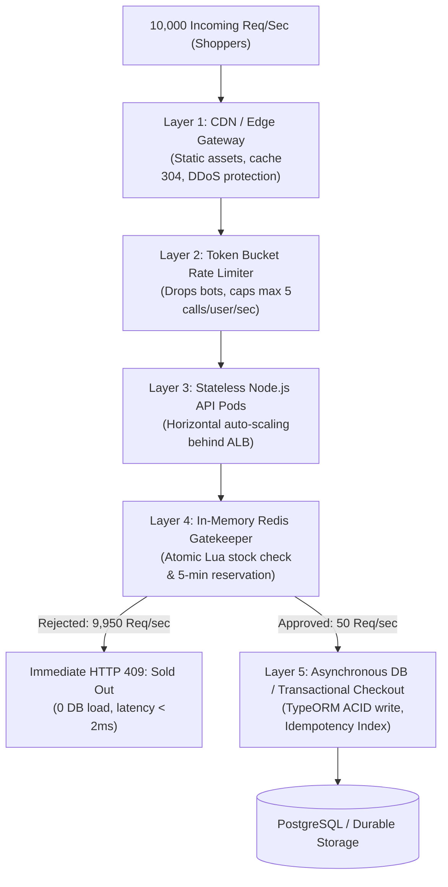

# FlashKart: Deep Dive Architecture Guide
**High Concurrency, Redis Concurrency Control, Zero Overselling & Data Consistency**

---

## 1. Executive Summary & Core Engineering Challenge

In a flash sale (e.g., Amazon Lightning Deals or Flipkart Big Billion Days), thousands of users attempt to purchase a strictly limited inventory (e.g., 50 items) within the exact same second.

If a platform relies on traditional relational database queries:
1. **The Check-Then-Act Race Condition** triggers: multiple threads read positive inventory before any thread decrements it, creating **overselling**.
2. **Database Row-Lock Bottlenecks** occur: `SELECT ... FOR UPDATE` causes connection pool exhaustion, extreme lock latency ($>500\text{ ms}$), and cascading timeouts.
3. **Casework Failure**: Inventory counts desynchronize, duplicate charges happen on browser reload, and system crashes under 10,000+ requests/sec.

FlashKart resolves these challenges using an **In-Memory Atomic Gatekeeper (Redis Lua)** paired with **Transactional Relational Persistence (TypeORM + PostgreSQL/SQLite)**.

---

## 2. High Concurrency: Sustaining 10,000 Requests/Second

### 2.1 The Request Funnel Architecture

Under peak flash load, requests must be filtered, cached, and thinned before hitting any persistent disk storage:



### 2.2 Key Concurrency Optimizations
1. **Zero Database Queries during Reservation Spike**:
   - `POST /cart/reserve` **never queries the database** to inspect stock.
   - All 10,000 requests/sec are resolved directly against Redis in memory at $< 2\text{ ms}$ latency.
2. **Horizontal Stateless Compute**:
   - Node.js API pods do not hold local session state.
   - Any pod can process any request, allowing Kubernetes Horizontal Pod Autoscaler (HPA) to scale pods linearly with CPU/traffic.
3. **Database Connection Pooling**:
   - Relational database connections are restricted to a tuned pool (e.g., 20 connections per pod), preventing database process exhaustion.

---

## 3. Redis Deep Dive & Race Condition Elimination

### 3.1 Why Redis?
| Characteristic | Traditional SQL Database | Redis In-Memory Engine |
| :--- | :--- | :--- |
| **Storage Medium** | Disk / SSD (I/O bound, WAL writes) | RAM (Memory bound) |
| **Throughput** | 1,000 – 3,000 operations/sec | 80,000 – 120,000 operations/sec per core |
| **Execution Model** | Multi-threaded with row/table locks | Single-threaded event loop |
| **Latency** | 25 – 150 ms | 0.5 – 2 ms |
| **Temporary State** | Bloats tables; requires cron deletions | Native `EXPIRE` / `TTL` keys |

### 3.2 The Single-Threaded Event Loop Guarantee
Redis processes commands sequentially on a single thread using an epoll/kqueue I/O multiplexer:
- Even when 5,000 Node.js workers hit Redis simultaneously, Redis queues them and executes them **strictly one after another**.
- There is no thread preemption, no context switching inside command execution, and no multi-threaded memory corruption.

### 3.3 Why Individual Redis Commands Are Not Enough
Executing discrete commands (`GET` then `DECR`) is still vulnerable:
```text
Client 1: GET flash:stock (returns 1)
Client 2: GET flash:stock (returns 1)  <-- Interleaved!
Client 1: DECR flash:stock (becomes 0)
Client 2: DECR flash:stock (becomes -1) <-- OVERSOLD!
```

### 3.4 The Solution: Atomic Lua Scripting
Redis executes Lua scripts **as a single, non-interruptible transaction**:
- When `reserve_stock.lua` runs, Redis pauses all other incoming commands until the script completes.
- Stock verification, stock decrement, reservation token generation, and TTL setting happen as **one atomic CPU operation**.

```lua
-- reserve_stock.lua (Executed inside Redis)
local stockKey = KEYS[1]
local resKey = KEYS[2]
local userResKey = KEYS[3]

local quantity = tonumber(ARGV[1])
local ttlSeconds = tonumber(ARGV[2])
local userId = ARGV[3]
local reservationId = ARGV[4]
local expiresAt = ARGV[5]

-- 1. Anti-Hoarding Check
if redis.call('EXISTS', userResKey) == 1 then
  return { -2, "User already holds an active reservation" }
end

-- 2. Atomic Stock Check
local currentStock = tonumber(redis.call('GET', stockKey))
if currentStock == nil or currentStock < quantity then
  return { 0, "Insufficient stock remaining" }
end

-- 3. Atomic Decrement & Reservation Hold
redis.call('DECRBY', stockKey, quantity)
redis.call('HSET', resKey, 'reservationId', reservationId, 'userId', userId, 'quantity', quantity, 'expiresAt', expiresAt)
redis.call('EXPIRE', resKey, ttlSeconds)
redis.call('SET', userResKey, reservationId, 'EX', ttlSeconds)

return { 1, "Reservation successful", tostring(currentStock - quantity) }
```

---

## 4. Overselling Prevention: Anatomy & Mathematical Proof

### 4.1 The Vulnerability: Read-Modify-Write (RMW) Race Condition
When stock is checked via application code:
```text
Time T0: Inventory = 1
Time T1: Worker A executes: SELECT stock FROM products (reads 1)
Time T2: Worker B executes: SELECT stock FROM products (reads 1)
Time T3: Worker A checks: if (1 >= 1) -> TRUE
Time T4: Worker B checks: if (1 >= 1) -> TRUE
Time T5: Worker A executes: UPDATE products SET stock = stock - 1 (stock = 0)
Time T6: Worker B executes: UPDATE products SET stock = stock - 1 (stock = -1)
Result: 2 Orders confirmed for 1 unit of stock!
```

### 4.2 FlashKart's Dual-Barrier Defense

FlashKart employs **Defense-in-Depth** across two layers:

```text
Incoming 10,000 Requests
         │
         ▼
┌──────────────────────────────────────────────┐
│  BARRIER 1: In-Memory Redis Lua Gatekeeper   │
│  • Single-threaded, atomic execution         │
│  • Decrements stock in RAM                   │
│  • Automatically stops when stock reaches 0  │
└──────────────────────┬───────────────────────┘
                       │ Exactly 50 pass
                       ▼
┌──────────────────────────────────────────────┐
│  BARRIER 2: Relational Database Constraints  │
│  • TypeORM Transaction with ACID isolation   │
│  • CHECK constraint: available_stock >= 0    │
│  • Optimistic Version Column (@VersionColumn)│
└──────────────────────────────────────────────┘
```

#### Mathematical Proof of Zero Overselling:
Let:
- $S_0$ = Initial inventory (e.g., 50).
- $R$ = Set of reservation attempts ($|R| = 10,000$).
- $S_k$ = Stock after $k$-th execution of atomic Lua script.

Because the Lua script executes under strict sequential consistency:
$$S_k = S_{k-1} - q_k \quad \text{if } S_{k-1} \ge q_k, \quad \text{else rejected}.$$

Since $S_k \ge 0$ invariant is maintained on every transition:
$$\sum_{i \in \text{Accepted}} q_i \le S_0.$$
It is physically and logically impossible for the accepted reservations to exceed $S_0$.

---

## 5. Data Consistency & Lifecycle Management

### 5.1 The Dual-State Architecture
A high-throughput flash sale platform operates across two data planes:

| Plane | System | Role | Authority |
| :--- | :--- | :--- | :--- |
| **Control Plane** | Redis (RAM) | Fast stock reservations & temporary 5-min holds | Authoritative for **Reservations** |
| **Persistence Plane**| PostgreSQL / DB | Financial orders, user history, audit logs | Authoritative for **Final Orders** |

### 5.2 The 5-Minute Reservation Lifecycle

```mermaid
sequenceDiagram
    autonumber
    actor Shopper as Customer Browser
    participant API as FlashKart Backend API
    participant Redis as Redis Cache (In-Memory)
    participant DB as PostgreSQL (TypeORM)

    Shopper->>API: POST /cart/reserve (productId, userId)
    API->>Redis: Execute reserve_stock.lua
    Redis-->>API: Success (Stock 50 -> 49, resId, TTL=300s)
    API-->>Shopper: HTTP 201 Reserved (5-minute countdown starts)

    alt Scenario A: Customer Completes Checkout Within 5 Mins
        Shopper->>API: POST /order/checkout (Idempotency-Key, resId)
        API->>Redis: HGETALL flash:res:{resId} (Validate token)
        Redis-->>API: Valid reservation token
        API->>DB: BEGIN Transaction
        API->>DB: Decrement product.availableStock
        API->>DB: INSERT into orders (status="CONFIRMED", idempotencyKey)
        API->>DB: COMMIT Transaction
        API->>Redis: DEL flash:res:{resId} (Consume token)
        API-->>Shopper: HTTP 201 Order Confirmed
    else Scenario B: Customer Abandons / 5 Minutes Expire
        Note over Redis: 300 seconds elapse; Redis evicts key via TTL
        Shopper->>API: POST /order/checkout (Expired resId)
        API->>Redis: HGETALL flash:res:{resId}
        Redis-->>API: NIL (Key expired & deleted)
        API-->>Shopper: HTTP 410 Reservation Expired
    else Scenario C: Payment Fails or DB Error During Checkout
        API->>DB: ROLLBACK Transaction
        API->>Redis: Execute release_stock.lua (INCRBY stock, DEL resKey)
        API-->>Shopper: HTTP 500 Checkout Failed (Stock returned to pool)
    end
```

---

## 6. Duplicate Checkout & Idempotency Engineering

### 6.1 The Problem: Double-Submit & Page Refresh
If a shopper clicks "Pay Now" twice or refreshes a slow checkout page, two identical HTTP requests reach the backend. Without idempotency protection:
- Both requests debit the customer's account.
- Two order records are inserted in the database.
- Inventory is deducted twice.

### 6.2 FlashKart's Idempotency Implementation

1. **Client-Side Intent UUID**:
   The frontend generates a unique UUID `Idempotency-Key` before initiating checkout:
   ```typescript
   const idempotencyKey = `idemp_${Date.now()}_${crypto.randomUUID()}`;
   ```
2. **Database Unique Index**:
   The `Order` entity enforces a database-level `UNIQUE` index on `idempotencyKey`:
   ```typescript
   @Index({ unique: true })
   @Column({ type: 'varchar', length: 128 })
   idempotencyKey!: string;
   ```
3. **Transactional Replay**:
   When `POST /order/checkout` arrives:
   - The backend checks if an order already exists with this key.
   - If found, it **safely replays** the previously confirmed order with `HTTP 200 OK` and `{ isIdempotentReplay: true }`.
   - No second payment, no duplicate order, and no double stock deduction can ever occur.

---

## 7. Disaster Recovery & Failure Modes

### 7.1 What Happens if Redis Crashes?
- **Persistence Settings**: Redis is configured with `AOF (Append Only File) everysec` and `RDB snapshots`. Data loss is constrained to $< 1$ second.
- **Sentinel Auto-Failover**: Redis Sentinel promotes a replica node to master within 2–3 seconds.
- **Cold Cache Auto-Priming**: FlashKart's `ProductController` and `CartController` detect uninitialized Redis keys and automatically prime the cache directly from persistent database stock.

### 7.2 What Happens if the Database Fails During Checkout?
- The TypeORM `queryRunner.rollbackTransaction()` unwinds any partially written database rows.
- The atomic Lua script `release_stock.lua` executes on Redis:
  - Deletes the failed reservation token.
  - Returns the reserved inventory back to the active pool (`INCRBY flash:stock quantity`).
  - Clears the user reservation lock, allowing the user (or another buyer) to claim the item.

---

## 8. Summary Checklist for Tech Leads

- [x] **Zero Overselling**: Enforced via atomic Redis Lua scripts (`reserve_stock.lua`) + DB check constraints.
- [x] **Sub-2ms Reservation**: Stock decrement happens in-memory; zero database writes during the initial traffic spike.
- [x] **5-Minute Reservation Hold**: Enforced via Redis key TTL (300 seconds); auto-evicted if abandoned.
- [x] **Anti-Hoarding**: Redis lock key `flash:user_res:{userId}:{productId}` prevents users from claiming multiple holds.
- [x] **Idempotent Checkout**: Guaranteed via client UUID keys and `UNIQUE` database indices on `orders.idempotency_key`.
- [x] **Automatic Rollback**: Redis stock restored atomically if database checkout fails.
- [x] **Automatic Cache Priming**: Cold Redis caches auto-synchronize with database inventory.
