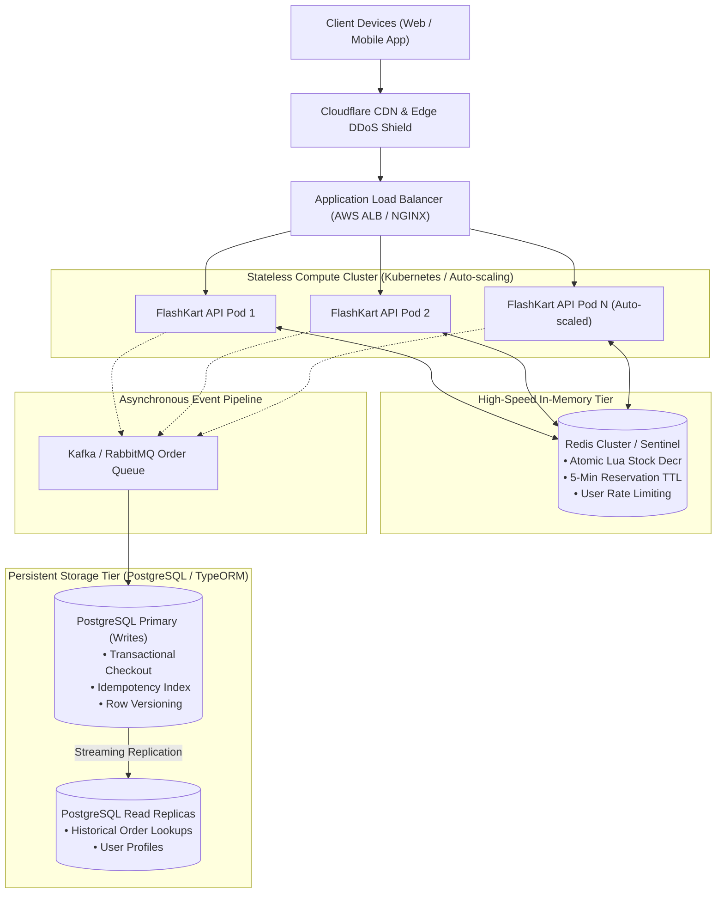

# FlashKart: System Design Document
**High-Concurrency Flash Sale Architecture (10,000 Requests/Second)**

---

## Section C1: High-Concurrency Architecture (10,000 req/sec)

During a high-profile flash sale (e.g., 50 limited-edition headphones at an 80% discount), traffic spikes instantly from baseline to tens of thousands of requests per second. A traditional relational database handling unbuffered read-modify-write queries would suffer from connection exhaustion, row lock contention, and cascading failure.

### 1. Architectural Blueprint



---

### 2. Core Strategies to Sustain 10,000 req/sec

#### 1. Edge & Reverse Proxy Layer (Traffic Shaping & Rate Limiting)
- **CDN Edge Caching**: Product metadata, static descriptions, images, and public sale countdown times are cached at Cloudflare/Fastly edge nodes with short TTLs (1–3 seconds) and `stale-while-revalidate`. 90%+ of read requests never touch backend compute.
- **Layer 7 Load Balancing**: NGINX / AWS ALB distributes incoming HTTP traffic using least-connection algorithms across a horizontally scalable pool of stateless Node.js application pods.
- **Token Bucket Rate Limiting**: Redis-backed sliding window / token bucket rate limiters reject malicious scrapers and bots before they reach core reservation logic (e.g., maximum 5 reservation attempts per IP/user per second).

#### 2. In-Memory Atomic Reservation Tier (Redis)
- **Zero Database Hits During Rush**: When 10,000 requests/sec hit `POST /cart/reserve`, the request **does not hit the database**. Stock deduction occurs strictly in-memory inside Redis via atomic Lua scripts in `< 2 milliseconds`.
- **Single-Threaded Event Loop Isolation**: Because Redis executes Lua scripts sequentially on its main thread, concurrent requests execute in strict atomic order. It is physically impossible for two requests to read the same stock value simultaneously and produce a race condition.
- **5-Minute Reservation Hold**:
  - `flash:stock:{productId}` decrements atomically.
  - `flash:res:{reservationId}` stores reservation metadata with a strict `300-second` TTL.
  - `flash:user_res:{userId}:{productId}` prevents individual users from reserving multiple units.

#### 3. Database Optimization & Connection Pooling
- **Connection Pooling**: Node.js microservices utilize connection pools (via `pg-pool` or TypeORM pool sizing, e.g., max 20 connections per pod) to prevent Postgres process exhaustion.
- **Optimistic Concurrency & Partial Write Locks**: In TypeORM, entities employ `@VersionColumn()` optimistic locking and strict check constraints (`availableStock >= 0`).
- **Read/Write Splitting**: Write transactions (Checkout) target the Primary database; read-heavy queries (order history, user profiles) target Read Replicas.

#### 4. Asynchronous Queue Buffering (Peak Offloading)
- While reservations are confirmed synchronously in Redis in real time, final checkout orders can be ingested into a durable Kafka/RabbitMQ topic. Worker consumers write to PostgreSQL at a steady, sustainable rate of 2,000 writes/sec, dampening the sudden spike and protecting database health.

---

## Section C2: Data Consistency & Disaster Recovery

### 1. Overselling Prevention Mechanism
FlashKart guarantees **Zero Overselling** through a dual-defense architecture:

1. **Gatekeeper (Redis Lua Script)**:
   ```lua
   local currentStock = tonumber(redis.call('GET', stockKey))
   if currentStock < quantity then
       return { 0, "Insufficient stock remaining" }
   end
   redis.call('DECRBY', stockKey, quantity)
   ```
   Stock is decremented in memory. If stock reaches 0, all subsequent requests immediately receive HTTP `409 Conflict (Sold Out)` without ever burdening the database.

2. **Final Barrier (Database Constraint)**:
   In the relational database, the `Product` table enforces:
   ```sql
   ALTER TABLE products ADD CONSTRAINT chk_stock_non_negative CHECK (available_stock >= 0);
   ```
   Even if an application bug bypassed cache logic, the database engine would reject any transaction attempting to decrement below zero.

---

### 2. Why Redis is Used for Reservations
| Requirement | Relational DB (SQL) | Redis In-Memory Engine |
| :--- | :--- | :--- |
| **Throughput** | 500 – 2,000 req/sec before lock contention | 50,000 – 100,000 ops/sec per node |
| **Latency** | 20 – 150 ms (row locks, WAL write, I/O) | 0.5 – 2 ms |
| **Concurrency Control** | Requires `SELECT ... FOR UPDATE` (causes deadlocks under 10k req/s) | Native atomic single-threaded Lua script execution |
| **Temporary State** | Bloats DB with transient expired cart holds | Native auto-expiry via `EXPIRE / TTL` (300 seconds) |

---

### 3. Eventual Consistency & Cache Reconciliation

- **Dual-State Model**:
  - **Redis**: Fast, real-time authoritative state for *flash reservations*.
  - **PostgreSQL**: Authoritative persistent source of truth for *financial and legal orders*.
- **Stock Sync Reconciliation Cron**:
  A background scheduled reconciliation worker runs every minute:
  $$\text{Effective Stock} = \text{Initial DB Stock} - (\text{Confirmed DB Orders} + \text{Active Redis Reservations})$$
  Any drift caused by expired keys or unhandled network drops is reconciled automatically.

---

### 4. Failure Scenarios & Recovery Strategies

#### Scenario A: Redis Node Crashes
- **Persistence**: Redis is configured with `AOF (Append Only File) everysec` and `RDB snapshots` to minimize data loss to $< 1$ second.
- **High Availability**: Redis Sentinel or Redis Cluster automatically promotes a replica to master within 2–3 seconds.
- **Cache Warmup & Recovery**:
  If Redis restarts empty, the system executes an automated recovery routine:
  1. Calculate remaining available stock: `Remaining = TotalStock - COUNT(ConfirmedOrders)`.
  2. Restore `flash:stock:{productId}` in Redis.
  3. Resume normal operations.

#### Scenario B: Database Failure During Checkout
- If PostgreSQL becomes temporarily unavailable during `POST /order/checkout`:
  1. The TypeORM transaction rolls back (`queryRunner.rollbackTransaction()`).
  2. The backend triggers the atomic Lua script `release_stock.lua` in Redis:
     - Deletes the reservation token.
     - Increments the stock back (`INCRBY flash:stock:{productId} quantity`).
     - Clears the user reservation lock.
  3. The user is informed with a retryable message, ensuring no inventory is permanently locked or leaked.
