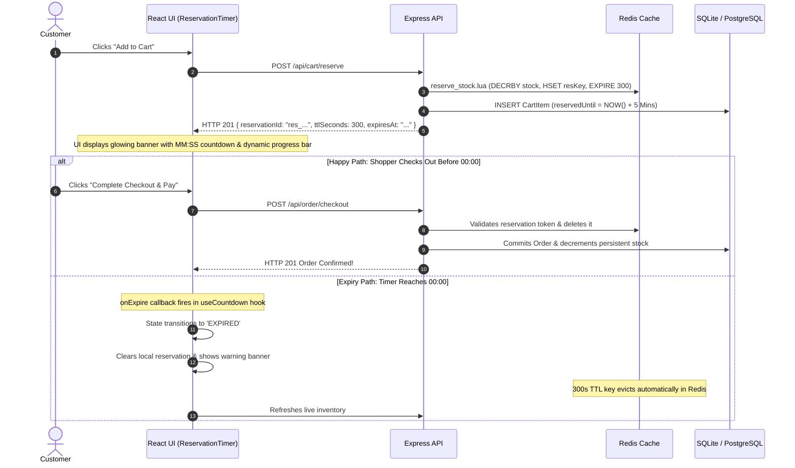

# FlashKart: Team Setup & Execution Guide
**Engineering Onboarding, Local Development & Testing Instructions**

---

## 📌 Quick Summary for Developers

| Service | Port / URL | Tech Stack | Auto-Reload |
| :--- | :--- | :--- | :--- |
| **Frontend UI** | [http://localhost:5173](http://localhost:5173) | React 19, Vite, TypeScript | ✅ Vite HMR |
| **Backend API** | [http://localhost:5000](http://localhost:5000) | Node.js, Express, TypeORM, ioredis | ✅ `tsx watch` |
| **Health Check** | [http://localhost:5000/health](http://localhost:5000/health) | JSON Status | — |
| **Active Flash Deal**| [http://localhost:5000/api/products/active](http://localhost:5000/api/products/active) | JSON Deal & Live Redis Stock | — |

---

## 🚀 1. First-Time Setup (One-Time)

### Prerequisites
- **Node.js**: `v18+` or higher (tested on `v22.x`)
- **npm**: `v9+` or higher
- *(Optional)* **Docker Desktop**: Only required if running real PostgreSQL & Redis containers instead of built-in SQLite and atomic in-memory cache.

### Step 1: Install All Dependencies Across Monorepo
From the project root (`FlashKart/`), install dependencies for the root orchestrator, backend, and frontend:

```bash
npm run install:all
```

*Or manually:*
```bash
npm install
cd backend && npm install && cd ..
cd frontend && npm install && cd ..
```

---

## ⚡ 2. Running the Full System (Recommended)

To start both the **Backend** and **Frontend** simultaneously with unified logging in a single terminal:

```bash
npm start
```
*(or `npm run dev`, or double-click `start.bat` on Windows)*

### Expected Terminal Output:
```text
[BACKEND]  [Database] TypeORM DataSource initialized successfully.
[BACKEND]  [Bootstrap] Primed Redis stock for product 36ddbd15-...: 50 units
[BACKEND]  🚀 FlashKart API Server running on http://localhost:5000
[FRONTEND] ➜  Local:   http://localhost:5173/
```

Open [`http://localhost:5173`](http://localhost:5173) in your browser to interact with the Flash Sale deal.

---

## 🛠️ 3. Running Services Independently

If you are working on a specific layer, you can run each service individually:

### Backend Only
```bash
cd backend
npm run dev
```
- Starts with `tsx watch src/server.ts` — any changes to `backend/src/` automatically hot-reload.
- Auto-seeds default demo product if not already present in the database.
- Listens on `http://localhost:5000`.

### Frontend Only
```bash
cd frontend
npm run dev
```
- Starts Vite development server at `http://localhost:5173`.
- Changes to React components hot-reload instantly via Vite HMR.

---

## 🧪 4. Running Concurrency & Idempotency Tests

The test suite validates the core high-concurrency requirements (50 parallel requests, race conditions, zero overselling, and duplicate checkouts):

### Run from Root
```bash
npm run test:concurrency
```

### Run from Backend Directory
```bash
cd backend
npm run test:concurrency
```

### What the Test Verifies:
1. **Zero Overselling (Concurrency Test)**:
   - Simulates 50 simultaneous parallel shoppers requesting reservations for an item with only 15 units.
   - **Assertion**: Exactly 15 reservations succeed (`HTTP 201`), 35 are rejected (`HTTP 409 Sold Out`), remaining Redis stock is exactly `0`.
2. **Duplicate Checkout Prevention (Idempotency Test)**:
   - Simulates a double-click / browser refresh sending duplicate checkout requests with identical `Idempotency-Key` headers.
   - **Assertion**: Replays the original order without creating duplicate orders in the database (`totalOrders === 1`).
3. **Expired Reservation Rejection**:
   - Attempts checkout with an invalid/expired token.
   - **Assertion**: Correctly rejected with `HTTP 410 Gone`.

---

## 🐳 5. Optional: Running with Docker (PostgreSQL & Redis)

By default, FlashKart runs out of the box with zero external dependencies (using local SQLite and an atomic in-memory Redis provider). 

To connect to real containerized PostgreSQL and Redis:

1. **Start Containers**:
   ```bash
   cd backend
   docker compose up -d
   ```
2. **Configure Backend `.env`**:
   Create `backend/.env`:
   ```env
   PORT=5000
   DB_TYPE=postgres
   DB_HOST=127.0.0.1
   DB_PORT=5432
   DB_USER=flashuser
   DB_PASSWORD=flashpassword
   DB_NAME=flashkart
   REDIS_HOST=127.0.0.1
   REDIS_PORT=6379
   USE_REAL_REDIS=true
   ```
3. Restart the backend: `npm run dev`.

---

## ⏱️ 6. 5-Minute Reservation Timer Architecture & UX

When a shopper clicks **"Add to Cart"**, the platform initiates an atomic 5-minute (300 seconds) reservation hold across both backend and frontend:

### How it Works (End-to-End):



### Visual & Technical Features in React (`ReservationTimer.tsx`):
1. **Live Countdown (`MM:SS`)**: Driven by the custom `useCountdown` hook with a 1-second interval ticker.
2. **Dynamic Progress Bar**: Visualizes the percentage of time remaining:
   $$\text{Percent Left} = \frac{\text{secondsRemaining}}{\text{initialSeconds}} \times 100$$
3. **Urgency Threshold Warning (< 60s)**:
   - When remaining time drops below 60 seconds, the banner shifts from soft green (`#10b981`) to flashing alert red (`#ef4444`) to urge the user to complete checkout.
4. **Auto-Expiry Handling**:
   - When the countdown reaches `00:00`, the `onExpire` callback automatically triggers:
     - Resets state from `RESERVED` $\rightarrow$ `EXPIRED`.
     - Displays an alert: *"Your 5-minute stock reservation has expired. The item was returned to the flash sale pool."*
     - Re-enables the "Add to Cart" button so the user can attempt to reserve again if stock remains.

---

## 🔍 7. Key API Endpoints Reference

| Method | Endpoint | Description | Payload / Headers |
| :--- | :--- | :--- | :--- |
| `GET` | `/health` | Service health check | None |
| `GET` | `/api/products/active` | Get active flash deal & live Redis stock | None |
| `GET` | `/api/products/:id` | Get product by ID | None |
| `POST` | `/api/cart/reserve` | Atomically reserve stock for 5 mins | `{ "userId": "...", "productId": "...", "quantity": 1 }` |
| `POST` | `/api/order/checkout` | Finalize transactional purchase | Header: `Idempotency-Key: <UUID>`<br>Body: `{ "userId": "...", "reservationId": "..." }` |
| `POST` | `/api/products/seed` | Reset & re-prime inventory in cache | `{ "stock": 50 }` |

---

## ❓ 8. Troubleshooting & FAQ

#### Q: Port 5000 is already in use (`EADDRINUSE`)
**Fix**: Another node instance is running in the background. Kill the existing process:
- **Windows (PowerShell)**:
  ```powershell
  Stop-Process -Id (Get-NetTCPConnection -LocalPort 5000).OwningProcess -Force
  ```
- **macOS / Linux**:
  ```bash
  kill -9 $(lsof -ti :5000)
  ```

#### Q: I made changes to backend TypeScript files but don't see them
**Fix**: Ensure you are running `npm start` or `cd backend && npm run dev`. We use `tsx watch` which automatically reloads on file save.

#### Q: Redis error "Product flash stock is not initialized"
**Fix**: The backend automatically primes Redis whenever `/products/active` or `/cart/reserve` is called. If testing via curl/Postman with a custom ID, call `POST /api/products/seed` first or use `productId: "active"`.
